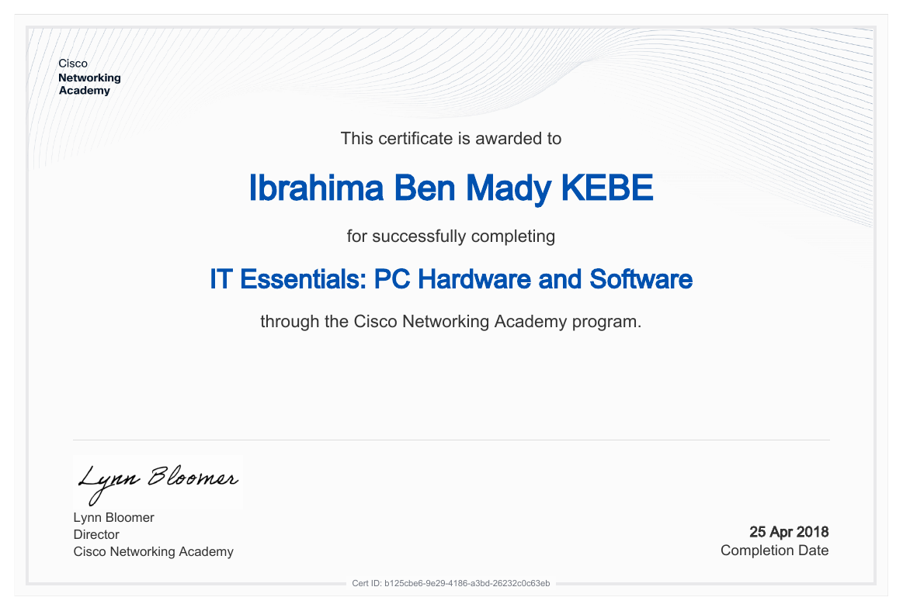
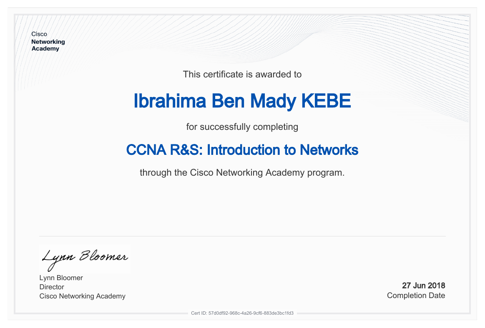

<!doctype html><html><head><meta charset=utf8><meta name=viewport content="width=device-width,initial-scale=1,viewport-fit=cover"></head><body>
<title>Ibrahima Ben Mady Kebe</title>
<meta name="claude:viewport-fit-sides" content="cover">
<link rel="stylesheet" href="https://fonts.googleapis.com/css2?family=Bricolage+Grotesque:wght@500;700;800&family=IBM+Plex+Sans:wght@400;500;600&family=IBM+Plex+Mono:wght@400;500&display=swap">

<header class="top">
  

    <a class="brand" href="#haut" aria-label="Ibrahima Kebe, haut de page">Ibrahima Kebe</a>
    <nav class="nav" aria-label="Sections">
      <a href="#profil">Profil</a>
      <a href="#certifications">Certifications</a>
      <a href="#experience">Expérience</a>
      <a href="#postes">Postes visés</a>
      <a href="#contact">Contact</a>
    </nav>
  

</header>

<main id="haut">
  <section class="hero">
    

      

        
Ibrahima Ben Mady Kebe · Montréal, QC

        <h1>La technique et la gestion, dans un seul profil.</h1>
        
Je configure des réseaux Cisco et je coordonne des opérations. Formé en informatique appliquée à la gestion, titulaire d'un MBA, je relie ce que les systèmes permettent à ce que l'équipe doit livrer.

        

          <a class="btn primary" href="#certifications">Voir mes certifications</a>
          <a class="btn" href="#contact">Me contacter</a>
        

      

      

        <svg viewBox="0 0 520 380" role="img" aria-labelledby="art-t art-d">
          <title id="art-t">Un réseau à gauche, un calendrier de projet à droite, reliés par un point central</title>
          <desc id="art-d">Des nœuds de réseau bleus à gauche et des barres de planification ambre à droite, reliés par un nœud central.</desc>
          <defs>
            <linearGradient id="core" x1="0" y1="0" x2="1" y2="0">
              <stop offset="0" style="stop-color: var(--ti)"/>
              <stop offset="1" style="stop-color: var(--ge-fill)"/>
            </linearGradient>
          </defs>
          <!-- réseau -->
          <path class="t-link" d="M60 70 L150 44 L190 140 L60 130 Z M190 140 L110 230 L60 130 M110 230 L200 290 L190 140 M60 130 L40 220 L110 230"/>
          <path class="t-flow" d="M190 140 L254 190 M200 290 L254 190"/>
          <circle class="t-node" cx="60" cy="70" r="7"/>
          <circle class="t-node d2" cx="150" cy="44" r="7"/>
          <circle class="t-node d3" cx="190" cy="140" r="9"/>
          <circle class="t-node d4" cx="60" cy="130" r="7"/>
          <circle class="t-node d5" cx="110" cy="230" r="8"/>
          <circle class="t-node d2" cx="200" cy="290" r="7"/>
          <circle class="t-node d3" cx="40" cy="220" r="6"/>
          <!-- planning -->
          <g class="g-grid"><path d="M330 56 V330 M380 56 V330 M430 56 V330 M480 56 V330"/></g>
          <rect class="g-bar" x="316" y="64" width="110" height="18" rx="4"/>
          <rect class="g-bar" x="352" y="104" width="128" height="18" rx="4" opacity=".85"/>
          <rect class="g-bar" x="330" y="144" width="70" height="18" rx="4"/>
          <rect class="g-bar" x="392" y="184" width="96" height="18" rx="4" opacity=".85"/>
          <rect class="g-bar" x="346" y="224" width="118" height="18" rx="4"/>
          <rect class="g-bar" x="318" y="264" width="86" height="18" rx="4" opacity=".85"/>
          <path class="g-flow" d="M266 190 L316 190"/>
          <!-- pont -->
          <circle cx="260" cy="190" r="22" fill="none" stroke="url(#core)" stroke-width="2" opacity=".5"/>
          <circle cx="260" cy="190" r="12" fill="url(#core)"/>
          <text class="svg-label" x="40" y="350" style="fill: var(--ti)">TI</text>
          <text class="svg-label" x="316" y="350" style="fill: var(--ge)">GESTION</text>
        </svg>
      

    

    

      <dl class="facts">
        
<dt>Formation</dt><dd>Bac. informatique appliquée à la gestion, MBA</dd>

        
<dt>Certifications</dt><dd>3 formations Cisco Networking Academy</dd>

        
<dt>Langues</dt><dd>Français et anglais</dd>

        
<dt>Recherche</dt><dd>Poste en TI, réseau ou coordination de projets</dd>

      </dl>
    

  </section>

  <section class="section" id="profil">
    

      

        

          
Profil hybride

          <h2>Ce que je fais côté TI, côté gestion, et là où les deux se rejoignent.</h2>
        

        
Les trois colonnes montrent mes compétences réelles. Filtre pour voir chaque côté. La colonne du centre regroupe ce qui sert aux deux : c'est là que mon profil se distingue.

      

      

        <button class="filter" type="button" data-f="all" aria-pressed="true">Tout voir</button>
        <button class="filter" type="button" data-f="ti" aria-pressed="false">Côté TI</button>
        <button class="filter" type="button" data-f="both" aria-pressed="false">Les deux</button>
        <button class="filter" type="button" data-f="ge" aria-pressed="false">Côté gestion</button>
      

      

        

          <h3>Côté TI</h3>
          
Réseaux, systèmes et support

          

            Cisco CLI
            TCP/IP
            IPv4 / IPv6
            Sous-réseaux
            VLAN et trunk
            Routage inter-VLAN
            OSPF
            STP
            EtherChannel
            DHCP
            NAT
            ACL
            HSRP
            Dépannage matériel
            Installation de systèmes
            Support aux utilisateurs
          

        

        

          <h3>Les deux</h3>
          
Ce qui relie les systèmes et les équipes

          

            Excel avancé
            Office 365
            Compilation de données
            Validation de données
            Systèmes d'inventaire
            Documentation rigoureuse
            Rapports et présentations
            Analyse de processus
            Français / English
          

        

        

          <h3>Côté gestion</h3>
          
Projets, équipes et opérations

          

            Suivi de projets
            Calendriers de projet
            Validation de livrables
            Feuilles de temps et horaires
            Coordination d'équipes
            Gestion d'événements
            Facturation mensuelle
            Analyse de dossiers de crédit
            Rédaction professionnelle
            MBA
          

        

      

      

        

          2022 – 2025
          <strong>MBA, Master of Business Administration</strong>
          Administration des affaires
        

        

          2017 – 2020
          <strong>Bac. en informatique appliquée à la gestion</strong>
          Systèmes informatiques et gestion de données
        

      

    

  </section>

  <section class="section" id="certifications">
    

      

        

          
Certifications

          <h2>Du poste de travail au réseau d'entreprise.</h2>
        

        
Trois formations Cisco Networking Academy, suivies dans cet ordre entre 2018 et 2019. Chaque étape ajoute une couche à la précédente. Clique sur un certificat pour l'agrandir.

      

      

        Matériel et systèmes<i></i>Réseau local<i></i>Réseau d'entreprise
      

      

        <article class="cert">
          <button class="cert-img" type="button" data-src="certificats/it-essentials.png" data-alt="Certificat IT Essentials : PC Hardware and Software" aria-label="Agrandir le certificat IT Essentials">
            
          </button>
          

            25 avril 2018
            <h3>IT Essentials : PC Hardware and Software</h3>
            <ul>
              <li>Assemblage, diagnostic et dépannage de matériel</li>
              <li>Installation et configuration de systèmes d'exploitation</li>
              <li>Support de premier niveau et notions de sécurité</li>
            </ul>
          

        </article>
        <article class="cert">
          <button class="cert-img" type="button" data-src="certificats/ccna-introduction-to-networks.png" data-alt="Certificat CCNA R&S : Introduction to Networks" aria-label="Agrandir le certificat CCNA Introduction to Networks">
            
          </button>
          

            27 juin 2018
            <h3>CCNA R&amp;S : Introduction to Networks</h3>
            <ul>
              <li>Modèles OSI et TCP/IP, adressage IPv4 et IPv6</li>
              <li>Sous-réseaux, Ethernet et commutation</li>
              <li>Configuration initiale de routeurs et commutateurs Cisco</li>
            </ul>
          

        </article>
        <article class="cert">
          <button class="cert-img" type="button" data-src="certificats/ccna-routing-and-switching-essentials.png" data-alt="Certificat CCNA R&S : Routing and Switching Essentials" aria-label="Agrandir le certificat CCNA Routing and Switching Essentials">
            
          </button>
          

            25 mars 2019
            <h3>CCNA R&amp;S : Routing and Switching Essentials</h3>
            <ul>
              <li>VLAN, trunk et routage inter-VLAN</li>
              <li>OSPF, STP, EtherChannel et HSRP</li>
              <li>DHCP, NAT et listes de contrôle d'accès</li>
            </ul>
          

        </article>
      

      
Attestations de cours délivrées par Cisco Networking Academy.

    

  </section>

  <section class="section" id="experience">
    

      

        

          
Expérience

          <h2>Quatre rôles où j'ai analysé, coordonné et documenté.</h2>
        

        
Chaque poste m'a appris à travailler avec des données fiables, des équipes différentes et des échéances précises. Ce sont les mêmes réflexes que j'applique en TI.

      

      

        <article class="xp-item">
          
<b>Fév. – Juin 2026</b>Magna Stainless et Aluminium

          

            <h3>Analyste traitement et entrée de données</h3>
            
Magna Stainless et Aluminium

            <ul>
              <li>Réception de l'inventaire et vérification quotidienne de la conformité.</li>
              <li>Mise à jour quotidienne des systèmes de gestion d'inventaire et de suivi.</li>
              <li>Vérification des certificats de conformité et traitement des documents de réception et d'expédition.</li>
              <li>Collaboration avec le crédit, la comptabilité, l'entrepôt et la livraison.</li>
            </ul>
            
DonnéesSystèmes d'inventaireConformité

          

        </article>
        <article class="xp-item">
          
<b>Jan. – Juil. 2025</b>Projet UQAM / Hôtel Monville

          

            <h3>Analyste projet, optimisation des opérations</h3>
            
Projet UQAM / Hôtel Monville

            <ul>
              <li>Suivi administratif complet de projets hôteliers et gestion documentaire méthodique.</li>
              <li>Compilation de données pour des rapports détaillés.</li>
              <li>Création de présentations pour appuyer la direction.</li>
              <li>Gestion des calendriers de projet, des feuilles de temps et validation des livrables.</li>
            </ul>
            
Suivi de projetRapportsPrésentations

          

        </article>
        <article class="xp-item">
          
<b>Juin 2022 – Mars 2026</b>Hôtel Monville, Montréal

          

            <h3>Événementiel banquet</h3>
            
Hôtel Monville

            <ul>
              <li>Gestion administrative d'événements corporatifs complexes, avec suivi des détails.</li>
              <li>Coordination d'équipes multidisciplinaires, des feuilles de temps et des horaires.</li>
              <li>Rédaction de correspondances, de rapports et de mémos liés aux opérations.</li>
              <li>Soutien aux directeurs et aux superviseurs, préparation des commandes d'équipement.</li>
            </ul>
            
Coordination d'équipesGestion d'événementsRédaction

          

        </article>
        <article class="xp-item">
          
<b>Sept. 2021 – Mai 2022</b>Bank of Africa

          

            <h3>Analyste crédit junior</h3>
            
Bank of Africa

            <ul>
              <li>Analyse de dossiers clients et montage de dossiers de crédit.</li>
              <li>Vérification de l'exactitude des informations critiques.</li>
              <li>Collaboration avec les équipes internes pour valider les dossiers et appuyer la décision.</li>
            </ul>
            
Analyse de dossiersValidation de données

          

        </article>
      

    

  </section>

  <section class="section" id="postes">
    

      

        

          
Postes visés

          <h2>Où mon profil s'applique le mieux.</h2>
        

        
Pour chaque type de poste, voici ce que j'apporte et de quel côté ça vient.

      

      

        <i class="dot ti"></i>Côté TI
        <i class="dot both"></i>Les deux
        <i class="dot ge"></i>Côté gestion
      

      

        <article class="role">
          <h3>Technicien en support informatique</h3>
          
Résoudre les problèmes des utilisateurs et garder les postes en état de marche.

          <ul>
            <li><i class="dot ti"></i>IT Essentials : matériel, systèmes, dépannage</li>
            <li><i class="dot ti"></i>Support aux utilisateurs et installation de postes</li>
            <li><i class="dot both"></i>Documentation rigoureuse des interventions</li>
            <li><i class="dot ge"></i>Service à la clientèle, en français et en anglais</li>
          </ul>
        </article>
        <article class="role">
          <h3>Technicien réseau junior</h3>
          
Configurer, surveiller et dépanner des réseaux locaux et d'entreprise.

          <ul>
            <li><i class="dot ti"></i>CCNA R&amp;S : VLAN, OSPF, STP, DHCP, NAT, ACL</li>
            <li><i class="dot ti"></i>Configuration de routeurs et commutateurs Cisco</li>
            <li><i class="dot both"></i>Documentation et suivi des configurations</li>
            <li><i class="dot ge"></i>Coordination avec les équipes et les fournisseurs</li>
          </ul>
        </article>
        <article class="role">
          <h3>Coordonnateur de projets TI</h3>
          
Tenir les échéances d'un projet en comprenant ce que la technique exige.

          <ul>
            <li><i class="dot ge"></i>MBA et suivi de projet (projet UQAM / Hôtel Monville)</li>
            <li><i class="dot ge"></i>Calendriers, feuilles de temps, validation des livrables</li>
            <li><i class="dot both"></i>Rapports et présentations pour la direction</li>
            <li><i class="dot ti"></i>Bases réseau et systèmes pour dialoguer avec les équipes TI</li>
          </ul>
        </article>
        <article class="role">
          <h3>Analyste opérations et données</h3>
          
Fiabiliser l'information qui circule entre les systèmes et les départements.

          <ul>
            <li><i class="dot both"></i>Excel avancé, compilation et validation de données</li>
            <li><i class="dot both"></i>Systèmes d'inventaire et de suivi (Magna)</li>
            <li><i class="dot ge"></i>Analyse de dossiers et de processus</li>
            <li><i class="dot ti"></i>Formation en informatique appliquée à la gestion</li>
          </ul>
        </article>
      

    

  </section>

  <section class="section contact" id="contact">
    

      

        
Contact

        <h2>Un poste à pourvoir ? Écrivez-moi.</h2>
        
Je réponds en français ou en anglais. Je suis à Montréal et je cherche un poste où la technique et la coordination travaillent ensemble.

      

      

        Courriel
        benmadykebe@gmail.com
        

          <button class="btn primary" type="button" id="copy">Copier l'adresse</button>
          <a class="btn" href="mailto:benmadykebe@gmail.com">Écrire un courriel</a>
        

        

      

    

  </section>
</main>

<footer>
  

    Ibrahima Ben Mady Kebe
    Montréal, QC · Français et anglais
  

</footer>

<dialog id="lb" aria-label="Certificat agrandi">
  

    
    <button class="close" type="button" id="lb-close">Fermer</button>
  

</dialog>

</body></html>
